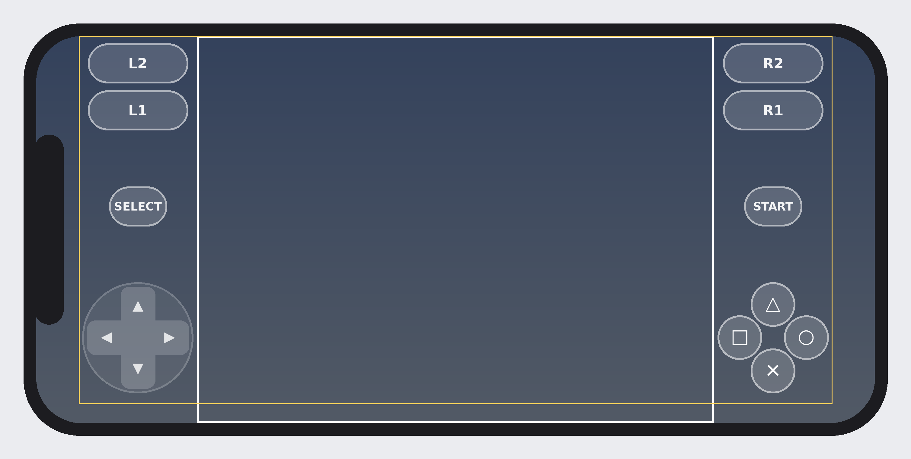
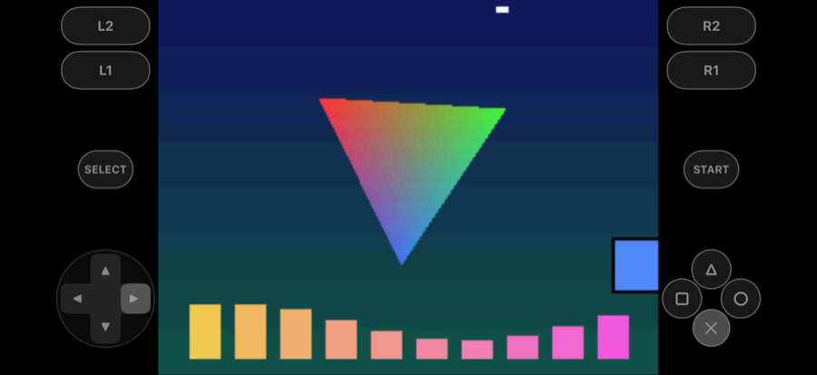

# ps-to-ios

Takes a **zip** of your own PS1 disc dump, recompiles the game's code ahead of
time to C with [psxrecomp](https://github.com/RetroPortingToolKit/psxrecomp),
and builds a **native, signed iPhone/iPad app** from it. No emulator and no JIT.
Graphics, sound and videos are read at run time from the disc image on the phone.

> This repository contains no game data and downloads none. Use it only with
> dumps of discs you own. psxrecomp is licensed under PolyForm Noncommercial
> 1.0.0, so the apps you build are for noncommercial use.

## How it works

```
game.zip ─► find the disc (cue/bin, chd, lone bin, iso; multi-disc sets)
        ─► SYSTEM.CNF → BOOT → PS-X EXE header → serial (e.g. SCES-00891)
        ─► project:  a curated profile if one exists (profiles/<SERIAL>.json),
                     otherwise psxrecomp's own scaffold (setup_project.sh)
        ─► recompile the game from the disc (psxrecomp generate)
        ─► iOS layer (ios/): Documents game folder, touch PS pad, MoltenVK
        ─► Xcode project → xcodebuild archive (automatic signing) → .ipa
        ─► (optional) install with devicectl + copy the disc to Documents/disc/
```

psxrecomp runs code in three tiers: ahead-of-time compiled code, overlays
compiled at run time, and a MIPS interpreter that is always correct. iOS does
not allow generating code at run time, so tier 2 is switched off. Code the
static pass did not find runs in the interpreter, which iOS allows. So **every
game should run correctly from the first build**. Games with a curated profile
are fully compiled ahead of time and run faster.

| Project kind | Games | Result |
|---|---|---|
| Curated | Hercules PAL: SCES-00891…00895 ([hercules-recompiled](https://github.com/obaidr1/hercules-recompiled)) | Full AOT, mods |
| Generic | Any other PS1 disc | Main EXE compiled, the rest interpreted; speed and compatibility vary by game |

To add a curated project, write `profiles/<SERIAL>.json` (repo, commit,
project folder, patches, GameData).

## Usage

Identifying a disc works anywhere, Linux included:

```bash
python3 -m ps1ios inspect "Game.zip"
```

Building the iPhone app needs a Mac:

```bash
python3 -m ps1ios build "Game.zip" --team TEAMID --human
```

With install and disc copy:

```bash
python3 -m ps1ios build "Game.zip" --team TEAMID --device <device-id> --human
```

Device id:

```bash
xcrun devicectl list devices
```

No Apple account? Build an unsigned IPA and let AltStore or Sideloadly sign it:

```bash
python3 -m ps1ios build "Game.zip" --unsigned --human
```

Or run it in the iPhone simulator and save a screenshot:

```bash
python3 -m ps1ios build "Game.zip" --target simulator --run-seconds 30 --human
```

Options: `--name` (home screen name), `--renderer auto|vulkan|software`
(auto uses Vulkan/MoltenVK when the Vulkan SDK is installed, the software
renderer otherwise), `--bios SCPH1001.BIN` (optional; OpenBIOS is used
otherwise), `--generic` (ignore curated profiles), `--bundle-prefix`,
`--work`, `--out`. Without `--human`, progress is printed as JSON lines in the
format HookLink and NX2Apple parse.

### Test ROM

`testrom/` is a small original PS1 program (GPU drawing, a box you move with
the pad) and a disc builder, so the whole pipeline can be tested without any
commercial game. `testrom/build.sh` writes `testrom/build/PS1 Test ROM.zip`
(needs `gcc-mipsel-linux-gnu`). The `ios-app` GitHub workflow builds it, turns
it into an iOS app, runs it in the iPhone simulator and keeps a screenshot.

### Mac requirements

- Xcode (iOS SDK); for a signed build an Apple Developer team ID (a free Personal Team works)
- `brew install cmake ninja git`, `pip3 install numpy pillow`
- Optional: LunarG Vulkan SDK (`glslc` + `MoltenVK.xcframework`, iOS component), with `VULKAN_SDK` set
- iPhone: iOS 16+, Developer Mode on

## Touch controls



*Layout drawing generated from the app's own layout code (`tools/render_pad_layout.py`),
not a game screenshot. The white frame is the 4:3 game picture, the yellow one the safe area.*

- **Out of the picture:** both thumb clusters, the shoulders and Select/Start sit in the
  side strips left over by the 4:3 picture, against the safe-area edge. On an iPhone
  13/14/15 Pro Max nothing covers the game. On narrower phones (e.g. 13 mini) the face
  buttons overlap the picture's edge by a few points, so targets stay full size.
- **D-pad you can roll on:** one control read by angle, 8 directions, a centre dead
  zone; diagonals are narrower (30°) than cardinals (60°) so running does not slip into
  a diagonal. The thumb can slide between directions without lifting.
- **Face buttons:** a diamond; a touch between two neighbours presses both (Cross+Square).
- **L1/L2/R1/R2** (L2/R2 as full triggers) and **Select/Start**; every target ≥ 44 pt
  with a hit area larger than its drawing.
- **Feel:** a light haptic tap on each new button and a tick when the d-pad changes
  direction; input goes to the game on the touch event itself; pressed controls light
  up; the pad brightens while touched; iOS edge swipes are deferred so a thumb near
  the edge is not taken by the system.
- **Settings app → the game:** pad size (0.8–1.3), opacity, haptics, and whether to
  keep the pad when a controller is connected (hidden by default).
- Layout and hit testing are plain C (`ios/src/pad_layout.c`), unit-tested on Linux
  for four iPhone sizes (`tests/test_pad_layout.py`).

## Files

| Path | What |
|---|---|
| `ps1ios/ingest.py` | Safe zip extraction (zip-slip, links, size caps), disc discovery, cue generation for lone bins, filename case fixes |
| `ps1ios/disc.py` | ISO9660 reading, SYSTEM.CNF, BOOT, PS-X EXE header, serial and region |
| `ps1ios/pipeline.py` | Curated/generic project, patches, generate, Xcode, signing, IPA, install |
| `ios/` | iOS layer: `ios_platform.mm` (Documents game folder, disc discovery, touch pad, run-time compile off), `pad_layout.c` (touch layout + hit testing), `Settings.bundle`, `ios.cmake`, `Info.plist.in`, psxrecomp patch |
| `tools/render_pad_layout.py` | Draws the touch layout from `pad_layout.c` |
| `profiles/` | Curated projects |
| `tests/` | Unit tests on synthetic discs (no game data) |

## Status



*Real screenshot from the `ios-app` workflow (iPhone 17 Pro Max simulator): the
original test ROM, recompiled by psxrecomp, running as an iOS app. The touch
pad's self-test holds Right + Cross, and the game moved the box right and
turned it blue: input reaches the recompiled game.*

Verified in CI on every push (`ios-app` workflow, Xcode 26):

- zip → disc → generic psxrecomp project → game C → iOS app, with no manual steps
- **simulator build runs**: OpenBIOS boots, the game loads from the disc in
  `Documents/disc/`, the software renderer draws through Metal, the touch pad
  drives player 1
- **unsigned iPhone IPA builds** (arm64, iphoneos SDK), downloadable from the
  workflow's artifacts, for AltStore/Sideloadly
- unit tests: zip ingestion, disc identification, project selection, game.toml
  edits (11), touch layout and hit testing (4); the iOS layer compiles with
  `-Werror` against the iOS SDK

Not verified yet:

- a **signed** build on a Mac with an Apple ID (`--team`), and running on a
  physical iPhone
- **commercial games**: only the original test ROM runs in CI. Curated
  projects (Hercules PAL) are fully compiled ahead of time; other games use the
  generic path, where code the static pass did not find runs in psxrecomp's
  interpreter, so speed and compatibility depend on the game
- the Vulkan/MoltenVK renderer (`--renderer vulkan`); the default is the
  software renderer

Other notes:

- Frame rate is capped by the game itself (most PS1 games step at 30 or 60 Hz).
- PS1 only. Despite the repository name, PS2 games are not supported.
